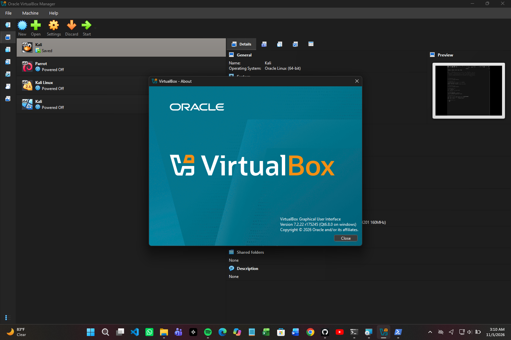
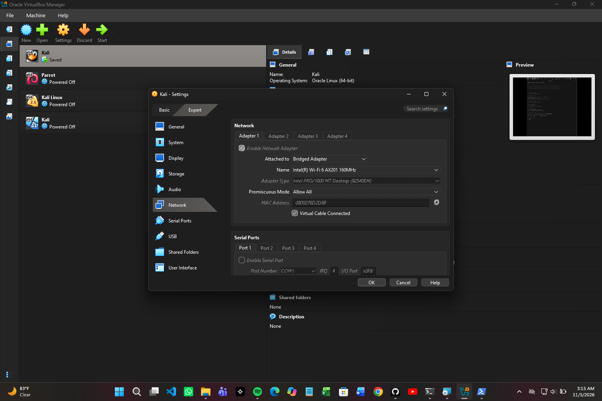
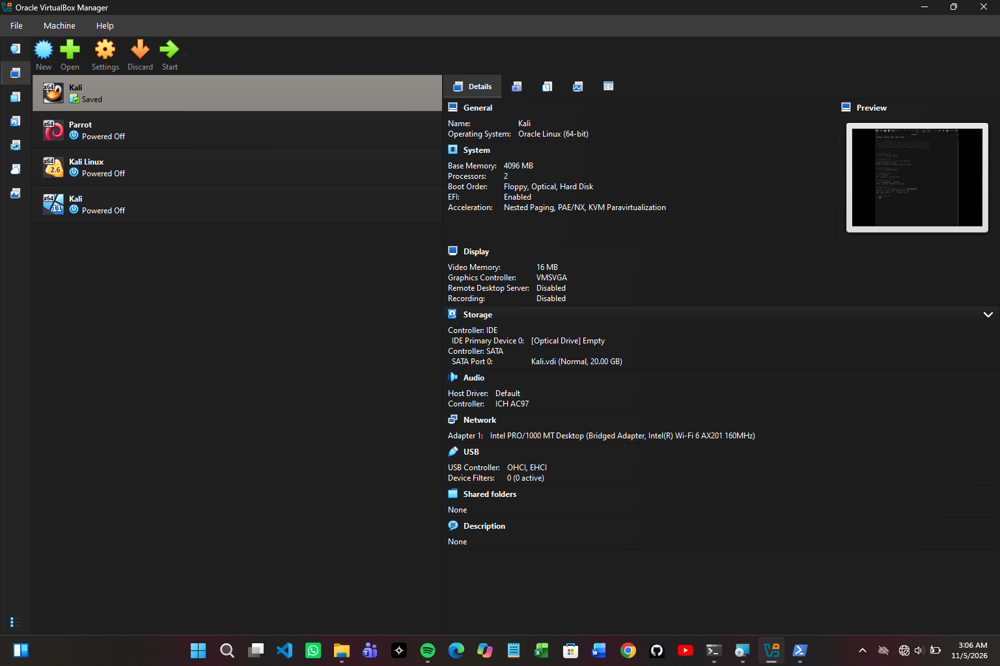
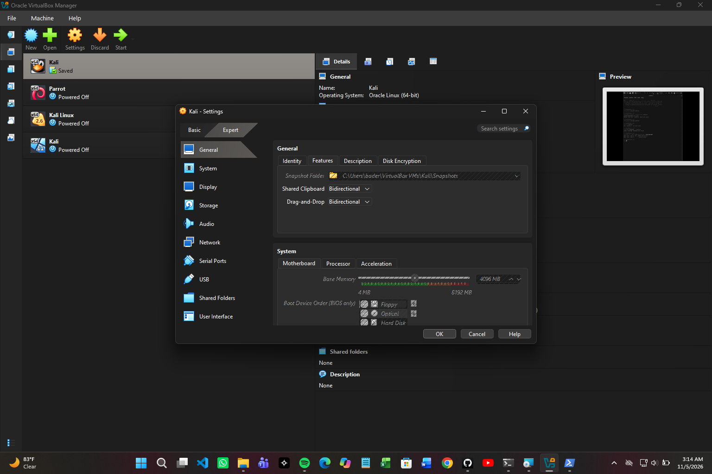
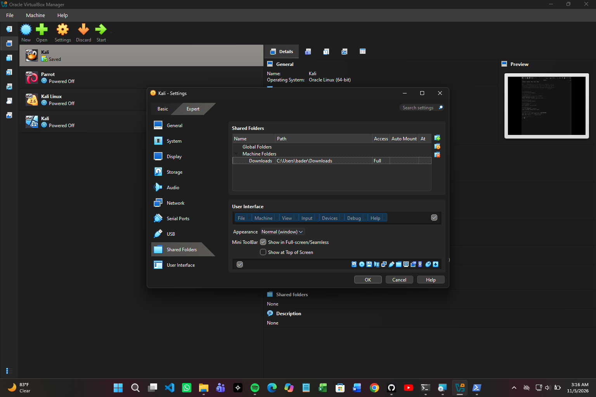
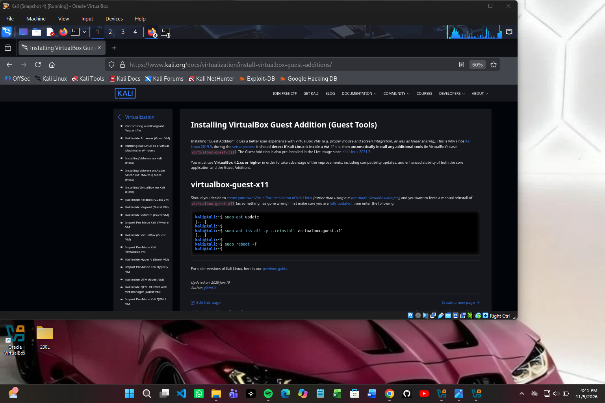
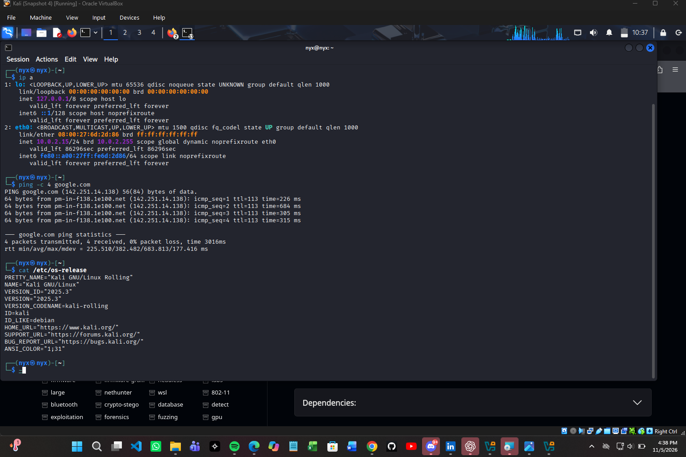

# 🔐 Cybersecurity Lab Environment Setup

**Building an isolated virtual lab for penetration testing and ethical hacking practice**


---

## 📌 Project Overview

This project sets up a **virtual cybersecurity and penetration-testing laboratory** using VirtualBox and Kali Linux, completed as **Week 1 / Project Module 1** of the Networkwalks Cybersecurity Internship (Batch B083).

The lab is a controlled environment where security tools, network scanning, reconnaissance and vulnerability assessment can be practiced safely and repeatably. It runs on a private virtual network, so additional machines can be added later as targets for authorized testing.

> ⚠️ **Disclaimer:** This lab is built on my own device for educational purposes only. All testing will be performed only on systems I own or in my lab environment.

---

## 🎯 Objectives

- Install VirtualBox (latest version) as the virtualization base
- Deploy Kali Linux (latest version) as the attacker VM
- Create a custom NAT Network using the `10.0.0.0/24` subnet
- Enable clipboard sharing and drag-and-drop between host and VM
- Share the host `Downloads` folder with the VM
- Assign Kali the static IP `10.0.0.2/24`
- Confirm full Internet access from Kali
- Take a snapshot as a clean backup

---

## 🏗️ Lab Architecture

| Component | Details |
|---|---|
| Host OS | [Windows 11 / Windows 10 / macOS / Linux] |
| Hypervisor | Oracle VirtualBox v[7.x.x] |
| Guest OS | Kali Linux 2026.2 (VirtualBox image, amd64) |
| Network type | NAT Network (custom): `NatNetwork` |
| Subnet | `10.0.0.0/24` |
| Kali IP | `10.0.0.2/24` (static) |
| Gateway | `10.0.0.1` |
| DNS | `8.8.8.8` |
| VM RAM / CPU | [e.g. 2048 MB / 2 CPUs] |

**Host machine specs:** [e.g. 8 GB RAM, 256 GB SSD, Core i5]

```
+-----------------------------------------------+
|  Host OS (Windows)                            |
|  +-----------------------------------------+  |
|  |  VirtualBox                             |  |
|  |  NAT Network: 10.0.0.0/24               |  |
|  |                                         |  |
|  |   [ Kali Linux ]  10.0.0.2/24           |  |
|  |        |                                |  |
|  |   Gateway 10.0.0.1 ---> Internet        |  |
|  +-----------------------------------------+  |
+-----------------------------------------------+
```

---

## 🛠️ Step-by-Step Implementation

### Step 1: Install 7-Zip

Kali's VirtualBox image is distributed as a compressed `.7z` archive, so I installed 7-Zip first to extract it.


### Step 2: Install VirtualBox

Downloaded and installed the latest VirtualBox from the official site.



### Step 3: Create the NAT Network (10.0.0.0/24)

1. Open VirtualBox → **File → Tools → Network**
2. Open the **NAT Networks** tab and click **Create**
3. Set the name to `NatNetwork`
4. Set the IPv4 prefix to `10.0.0.0/24`
5. Tick **Enable DHCP** and click **Apply**



### Step 4: Download and Import Kali Linux

1. Downloaded the pre-built Kali VirtualBox image (amd64) from the official Kali site
2. Extracted it with 7-Zip
3. Added the `.vbox` file to VirtualBox (**Machine → Add**)



### Step 5: Configure the Kali VM Settings

**Network:** Adapter 1 → Attached to **NAT Network** → Name: `NatNetwork`


**Clipboard and drag-and-drop:** General → Advanced → set both to **Bidirectional**



**Shared folder:** Shared Folders → add the host `Downloads` folder (Auto-mount enabled)



### Step 6: Set the Static IP on Kali (10.0.0.2/24)

Inside Kali: Network icon → **Edit Connections** → *Wired connection 1* → **IPv4 Settings**

| Field | Value |
|---|---|
| Method | Manual |
| Address | `10.0.0.2` |
| Netmask | `24` |
| Gateway | `10.0.0.1` |
| DNS servers | `8.8.8.8` |

![Static IP configuration]

### Step 7: Take a Snapshot

Took a snapshot of the clean, working VM so I can roll back anytime.

**Snapshot name:** `[My Fresh Kali Linux after installation]`



---

## ✅ Verification

Commands run inside Kali to confirm the setup:

```bash
ip a                    # confirm 10.0.0.2/24 on eth0
ip route                # confirm default gateway 10.0.0.1
ping -c 4 8.8.8.8       # test Internet connectivity (by IP)
ping -c 4 google.com    # test DNS resolution
```




| Requirement | Status |
|---|---|
| VirtualBox (latest) installed | ✅ |
| Kali Linux (latest) running as VM | ✅ |
| NATNetwork using 10.0.0.0/24 | ✅ |
| Clipboard and drag-and-drop enabled | ✅ |
| Shared folder (Downloads) enabled | ✅ |
| Kali IP is 10.0.0.2/24 | ✅ |
| Full Internet access | ✅ |
| Snapshot taken | ✅ |

---

## 🧰 Troubleshooting

### Problem: Kali lost Internet after setting the static IP

**Cause:**

**Solution:**
```bash
# [Replace with the commands/steps you actually used]
sudo nmcli connection modify "Wired connection 1" ipv4.dad-timeout 0
sudo nmcli connection down "Wired connection 1"
sudo nmcli connection up "Wired connection 1"
```

Other checks that help:
- Confirm the NAT Network was created correctly and is selected on the VM
- Make sure no other VM on the same NAT Network uses `10.0.0.2`
- Try DNS `10.0.0.1` instead of `8.8.8.8`
- Check whether the host firewall or antivirus is blocking traffic
- Restart the VM and the host OS 

---

## 📚 What I Learned

- How virtualization isolates a hacking lab from my main OS
- How NAT Networks let VMs talk to each other and the Internet on a private subnet
- How to assign and verify static IP configuration in Kali Linux
- Why snapshots matter: a safe restore point before experimenting
  

---

## 🚀 Next Steps

- Add intentionally vulnerable target VMs to the same `10.0.0.0/24` network
- Practice scanning and enumeration with Nmap and Wireshark inside the lab
- Build on this lab in the coming weeks of the program

---

## ⚖️ Legal & Ethical Notice

All activity in this project takes place in a private virtual lab on hardware I own. Hacking or scanning systems without written permission from the owner is illegal. I will only test systems that I own or am explicitly authorized to test.

---

## 👤 Author

Oluwafunbi Bader
Cybersecurity Intern, Networkwalks (Batch B083)
🔗 LinkedIn: www.linkedin.com/in/oluwafunbi-bader-167423390
🐙 GitHub: https://github.com/Funbi167/NETWORKWALKS-FUNBI-B083-WK1-PM1-CYBERSECURITY-LAB-SETUP/edit/main/README.md

*Instructor: Waqas Karim CCIE*
